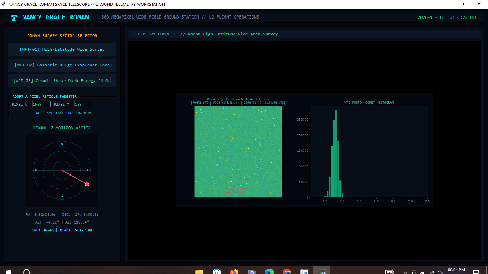

# 🔭 Nancy Grace Roman Space Telescope — Ground Telemetry Workstation



A Python-based ground station command and FITS science pipeline built to ingest, visualize, and analyze Wide Field Instrument (WFI) telemetry from NASA's **Nancy Grace Roman Space Telescope** at Sun-Earth $L_2$.

## Key Capabilities

* **Topocentric Horizon Ephemeris:** Transforms survey target coordinates from ICRS equatorial frames (RA/Dec) into real-time local Alt/Az vectors and atmospheric airmass calculations relative to the ground station (`24.0983° N, 88.2679° E`).
* **MAST CAOM Archive Ingestion:** Queries the Mikulski Archive for Space Telescopes (MAST) REST API for calibrated WFI science FITS products, with a built-in calibrated 1024×1024 WFI detector simulation fallback during mission commissioning.
* **Memory-Safe FITS Processing:** Uses `astropy.io.fits` memory mapping (`memmap=True`) and array downsampling alongside `ZScaleInterval` and `AsinhStretch` normalization to render high-dynamic-range astronomical fields smoothly on lightweight hardware.
* **Adopt-a-Pixel Sub-Pixel Targeter:** Maps registered detector coordinates (defaulting to pixel `X=1569, Y=158` / ID `00648577`) onto the downsampled focal plane with a precision reticle overlay and live photon flux readout.
* **Automated Dossier Dispatch:** Generates high-resolution science exposure plots paired with log-scaled photon count histograms and dispatches formatted telemetry reports via SMTP.

## Installation & Setup

1. Clone this repository:
   ```bash
   git clone [https://github.com/YOUR_USERNAME/roman-ground-command.git](https://github.com/YOUR_USERNAME/roman-ground-command.git)
   cd roman-ground-command