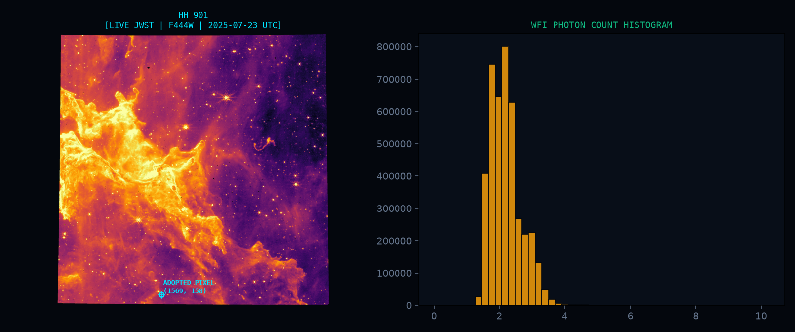

# Roman Ground Command (v3 Beta 2)


A lightweight Python telemetry workstation, multi-band Lupton RGB composite engine, and Plain-English Science Translator built for the **Nancy Grace Roman Space Telescope** ahead of its December 7, 2026 first-light public data release.

Roman's 300-megapixel Wide Field Instrument (WFI) publishes 100% of its calibrated science exposures directly to NASA's MAST archive with zero proprietary lock period. **Roman Ground Command** lets anyone query those `.asdf` and `.fits` exposures on a standard laptop, inspect specific detector coordinates, and read human-friendly translations of the underlying astrophysics.

## Live Calibration Output (`HH 901` / JWST `F444W`)



*Live MAST pipeline test on JWST NIRCam F444W data (`HH 901` in the Carina Nebula), demonstrating detector reticle targeting and WFI-style photon count distribution histograms.*

## Key Features (v3 Beta 2)
* **Live MAST Pipeline & Calibration Support:** Queries Roman WFI `.asdf` exposures and live JWST MAST `.fits` calibration frames, with a built-in 3-band synthetic fallback when offline.
* **Multi-Band Lupton RGB Engine:** Automatically sorts short, mid, and long infrared filters by wavelength and blends them into calibrated `asinh`-stretched color composites using `astropy.visualization.make_lupton_rgb`.
* **Dual-Pixel Reticle Targeter:** Tracks two independent `(X, Y)` coordinates simultaneously across the `4088 × 4088` WFI detector grid to compare target sources against dark sky baselines.
* **Plain-English Science Translator:** Converts raw signal-to-noise ratios, infrared filter wavelengths, horizon elevation, and pixel flux values into plain, readable summaries right inside the GUI.
* **Optional Automated Email Briefings:** Dispatches formatted telemetry reports with attached RGB composites and photon histograms via SMTP when configured.

## Installation

1. Clone the repository:
   ```bash
   git clone https://github.com/aryadeepchattopadhyay-pixel/roman-ground-command.git
   cd roman-ground-command
   ```

2. Install dependencies:
   ```bash
   pip install -r requirements.txt
   ```

## Usage

Run the workstation directly with default settings (reports save locally to `reports_live/`):
```bash
python drn_master3_beta2.py
```

### Optional Environment Configuration
Customize your observer coordinates, default tracked pixels, or email alerts without modifying the source code:

| Variable | Description | Default |
| :--- | :--- | :--- |
| `ROMAN_STATION_NAME` | Custom header label for your ground station | `ROMAN GROUND COMMAND // GROUND STATION` |
| `ROMAN_STATION_LAT` | Observer latitude in degrees | `0.0` |
| `ROMAN_STATION_LON` | Observer longitude in degrees | `0.0` |
| `ROMAN_STATION_ELEV` | Observer elevation in meters | `0.0` |
| `ROMAN_PX1_X` / `ROMAN_PX1_Y` | Default coordinates for Cyan Reticle (`PX1`) | `2044` / `2044` |
| `ROMAN_PX2_X` / `ROMAN_PX2_Y` | Default coordinates for Gold Reticle (`PX2`) | `1024` / `1024` |
| `ROMAN_SENDER_EMAIL` | Gmail address for automated telemetry briefings | *(disabled if unset)* |
| `ROMAN_RECIPIENT_EMAIL` | Destination email address for reports | `ROMAN_SENDER_EMAIL` |
| `ROMAN_APP_PASS` | Gmail App Password (or store in `roman_secret.txt`) | *(disabled if unset)* |

## Repository Structure
* `drn_master3_beta2.py` — Main Tkinter ground station application, MAST fetcher, RGB compositor, and science translator (`v3 Beta 2`).
* `drn_master2.py` — Previous v2 telemetry release.
* `preview2.png` — Workstation GUI preview showing dual-pixel tracking and plain-English telemetry translation.
* `ROMAN_V3_RGB_HH_901.png` — Live MAST JWST F444W calibration render and photon count histogram.
* `requirements.txt` — Required Python packages (`astropy`, `astroquery`, `roman_datamodels`, `matplotlib`, `Pillow`, `numpy`).
