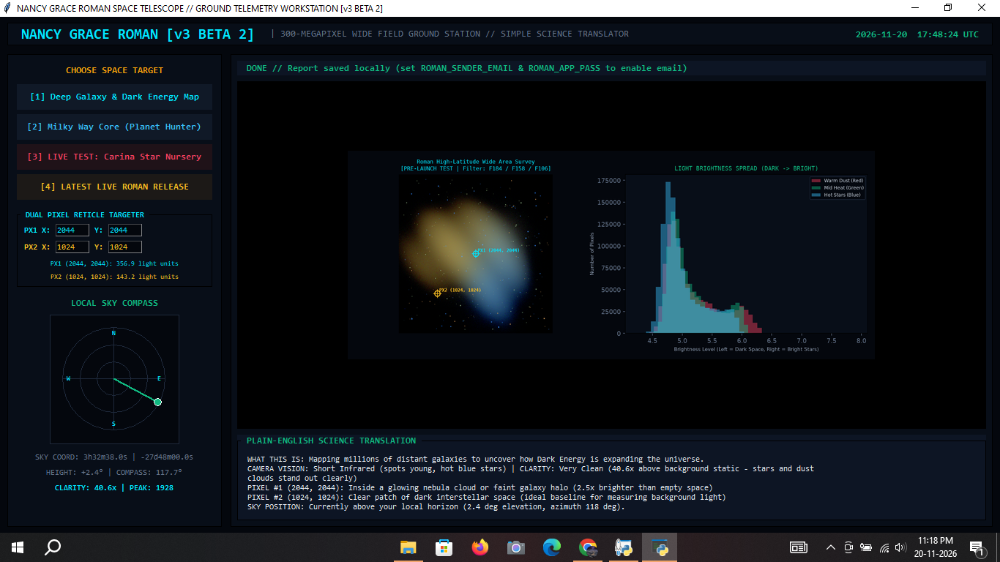

# Roman Ground Command (v3 Beta 2)



A lightweight Python telemetry workstation, multi-band Lupton RGB composite engine, and Plain-English Science Translator built for the **Nancy Grace Roman Space Telescope** ahead of its December 7, 2026 first-light public data release.

Roman's 300-megapixel Wide Field Instrument (WFI) publishes 100% of its calibrated science exposures directly to NASA's MAST archive with zero proprietary lock period. **Roman Ground Command** lets anyone query those `.asdf` and `.fits` exposures on a standard laptop, inspect specific detector coordinates, and read human-friendly translations of the underlying astrophysics.

## Key Features (v3 Beta 2)
* **Live MAST Pipeline & Calibration Support:** Queries Roman WFI `.asdf` exposures and live JWST MAST `.fits` calibration frames, with a built-in 3-band synthetic fallback when offline.
* **Multi-Band Lupton RGB Engine:** Automatically sorts short, mid, and long infrared filters by wavelength and blends them into calibrated `asinh`-stretched color composites using `astropy.visualization.make_lupton_rgb`.
* **Dual-Pixel Reticle Targeter:** Tracks two independent `(X, Y)` coordinates simultaneously across the `4088 × 4088` WFI detector grid to compare target sources against dark sky baselines.
* **Plain-English Science Translator:** Converts raw signal-to-noise ratios, infrared filter wavelengths, horizon elevation, and pixel flux values into plain, readable summaries right inside the GUI.
* **Optional Automated Email Briefings:** Dispatches formatted telemetry reports with attached RGB composites and photon histograms via SMTP when configured.

## Installation

1. Clone the repository:
   ```bash
   git clone [https://github.com/aryadeepchattopadhyay-pixel/roman-ground-command.git](https://github.com/aryadeepchattopadhyay-pixel/roman-ground-command.git)
   cd roman-ground-command
